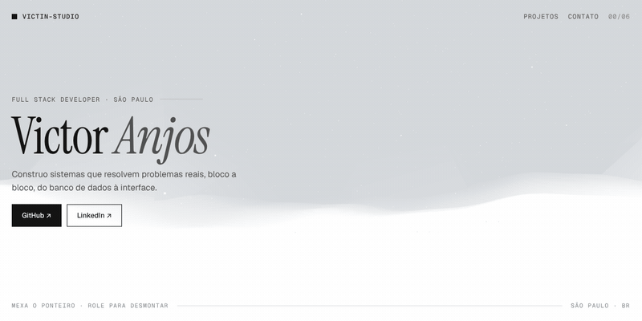
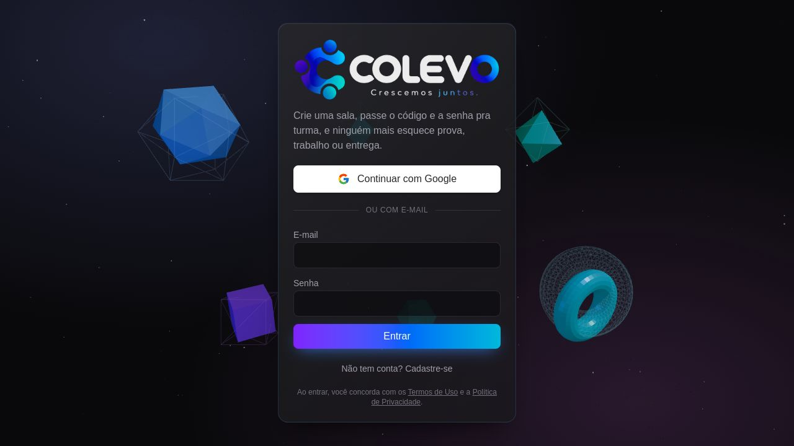
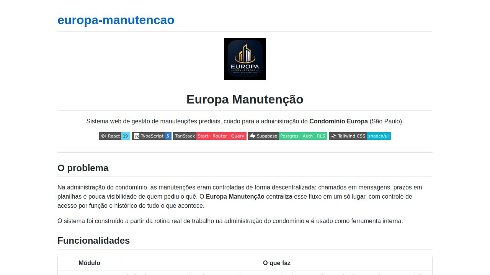
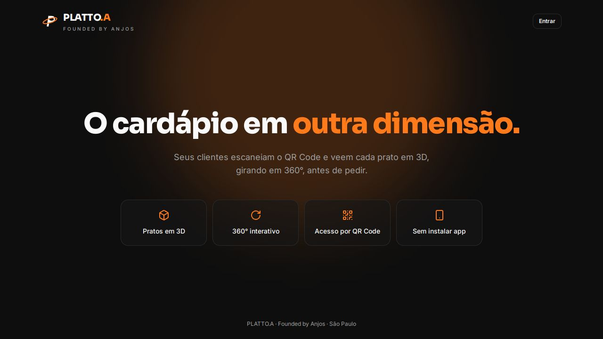
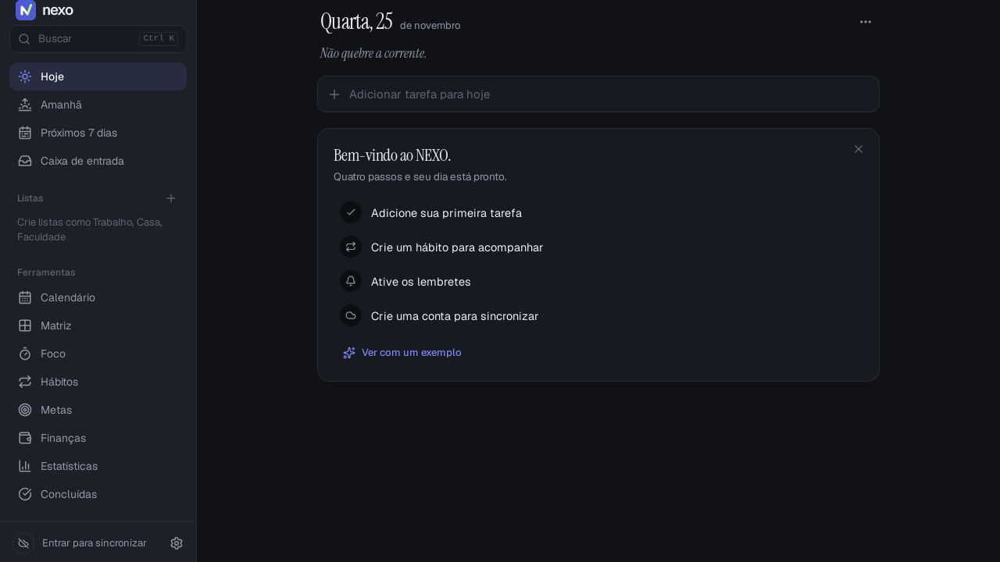
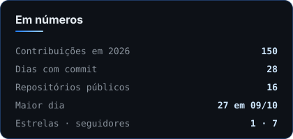
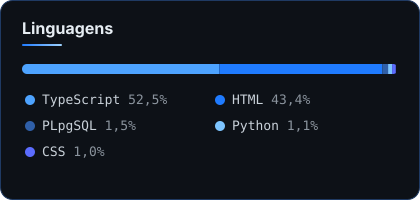

  

  

  
  
  
  
  
  

### 🎬 Meu portfólio em 3D

  
   Clique para abrir o <b>Victin-Studio</b> e role a página para ver o retrato virar os projetos.

### 🚀 Projetos em destaque

<table>
  <tr>
    <td width="50%" valign="top">
      
      <h4>Colevo</h4>
      
Salas para a turma da faculdade organizar provas, entregas, lembretes e materiais. Usado pela minha turma de ADS.

      <a href="https://victin7.github.io/Colevo/">abrir</a> · <a href="https://github.com/Victin7/Colevo">código</a>
    </td>
    <td width="50%" valign="top">
      
      <h4>Europa Manutenção</h4>
      
Gestão de manutenção predial criada na administração do Condomínio Europa e usada no dia a dia.

      <a href="https://victin7.github.io/europa-manutencao/">abrir</a> · <a href="https://github.com/Victin7/europa-manutencao">código</a>
    </td>
  </tr>
  <tr>
    <td width="50%" valign="top">
      
      <h4>PLATTO.A</h4>
      
SaaS de cardápios digitais com pratos em 3D, acessados pelo QR Code da mesa. Código privado.

      <a href="https://platto-a.vercel.app">abrir</a> · <a href="https://github.com/Victin7/platto.a-apresentacao">apresentação</a>
    </td>
    <td width="50%" valign="top">
      
      <h4>NEXO</h4>
      
Planejador diário com tarefas, hábitos, metas, pomodoro e finanças, sincronizado entre aparelhos.

      <a href="https://nexo-eight-psi.vercel.app">abrir</a> · <a href="https://github.com/Victin7/NEXO">código</a>
    </td>
  </tr>
</table>

Também: **[StockWise](https://github.com/Victin7/Stockwise)**, SaaS de gestão de estoque para pequenas e médias empresas.

### 🔒 Projetos com código privado

| Projeto | Sobre |
|---|---|
| **BossFit AI** | Plataforma fitness com coach de IA, treinos, nutrição e gamificação (web/PWA + API no Railway) |
| **Europa Manutenção v2** | Nova versão do sistema do condomínio: TanStack Start, Supabase e Vercel |
| **Prumo** | Finanças pessoais para CLT e autônomos: quanto vai sobrar no mês, contas fixas e metas |

### 🧪 Em desenvolvimento

- **AnjosUp**: gamificação e engajamento para equipes de telemarketing
- **CineAnjos**: app para avaliar filmes e séries, no estilo Letterboxd

### ⚡ Mexendo agora

<!--AGORA:INICIO-->
- **[VinoFlow-Apresentacao](https://github.com/Victin7/VinoFlow-Apresentacao)** · atualizado hoje
- **[Colevo](https://github.com/Victin7/Colevo)**: Salas para a turma da faculdade se organizar: provas, entregas, lembretes por e-mail e materiais em um só lugar. · atualizado ontem
- **[Pata-Amiga](https://github.com/Victin7/Pata-Amiga)**: Site institucional da ONG fictícia Pata Amiga, contra a fome e o abandono de pets. Projeto Integrador da UNICID. · atualizado ontem
- **[Victin-Anjos](https://github.com/Victin7/Victin-Anjos)**: Esse repositório irá dizer um pouco sobre mim. · atualizado ontem
<!--AGORA:FIM-->

Lista atualizada sozinha todo dia com os repositórios em que mexi por último.

### 🕸️ Meu ano no GitHub

  

  
  

### 📫 Contato

  
  
  

