  

  

  
  
  
  
  
  

---

### 🚀 Projetos em destaque

| Projeto | Sobre | Links |
|---|---|---|
| **Colevo** | Salas para a turma da faculdade organizar provas, entregas, lembretes e materiais. Usado pela minha turma de ADS | [código](https://github.com/Victin7/Colevo) · [abrir](https://victin7.github.io/Colevo/) |
| **Europa Manutenção** | Gestão de manutenção predial criada na administração do Condomínio Europa e usada no dia a dia | [código](https://github.com/Victin7/europa-manutencao) · [abrir](https://victin7.github.io/europa-manutencao/) |
| **PLATTO.A** | SaaS de cardápios digitais com pratos em 3D, acessados pelo QR Code da mesa (código privado) | [apresentação](https://github.com/Victin7/platto.a-apresentacao) |
| **NEXO** | Planejador diário com tarefas, hábitos, metas, pomodoro e finanças, sincronizado entre aparelhos | [código](https://github.com/Victin7/NEXO) · [abrir](https://nexo-eight-psi.vercel.app) |
| **StockWise** | SaaS de gestão de estoque para pequenas e médias empresas | [código](https://github.com/Victin7/Stockwise) |

### 🔒 Projetos com código privado

| Projeto | Sobre |
|---|---|
| **BossFit AI** | Plataforma fitness com coach de IA, treinos, nutrição e gamificação (web/PWA + API no Railway) |
| **Europa Manutenção v2** | Nova versão do sistema do condomínio: TanStack Start, Supabase e Vercel |
| **Prumo** | Finanças pessoais para CLT e autônomos: quanto vai sobrar no mês, contas fixas e metas |

### 🧪 Em desenvolvimento

- **AnjosUp**: gamificação e engajamento para equipes de telemarketing
- **CineAnjos**: app para avaliar filmes e séries, no estilo Letterboxd

---

### 📫 Contato

  
  
  

  
  

