  

  

  
  
  
  
  
  

---

### 🚀 Projetos em destaque

| Projeto | Sobre |
|---|---|
| **[NEXO](https://github.com/Victin7/nexo)** | App de hábitos, metas e finanças pessoais |
| **[StockWise](https://github.com/Victin7/stockwise)** | SaaS de gestão de estoque para pequenas e médias empresas |
| **AnjosUp** | Plataforma de gamificação e engajamento para equipes de telemarketing |
| **CineAnjos** | App para avaliar filmes e séries, no estilo Letterboxd |
| **Europa Manutenção** | Sistema de gestão de manutenção para condomínios |

---

### 📫 Contato

  
  

  
  

